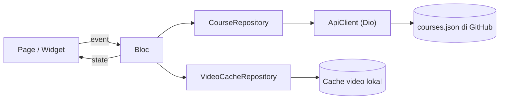
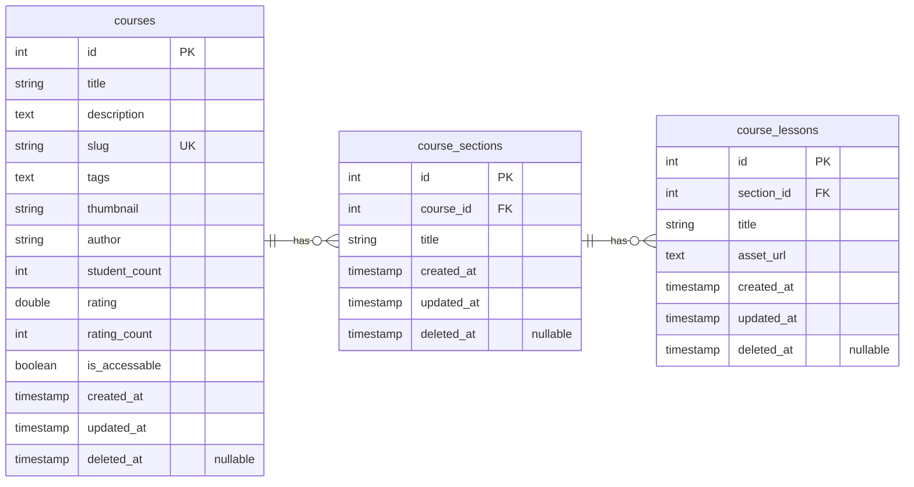

Aplikasi e-learning berbasis video pendek, dibuat dengan Flutter. Video vertikal ala TikTok, tapi dikelompokkan per course dan section.

## Fitur Utama

- **Home**: daftar _Recent Courses_ (horizontal) dan _Top Rated Courses_ (vertikal).
- **All Courses**: grid responsif (2 kolom, 3 kolom jika lebar layar > 480), infinite scroll, dan pencarian dengan debounce 250 ms (minimal 3 karakter).
- **Course Detail**: deskripsi yang bisa di-expand, daftar section yang bisa di-expand, dan daftar lesson di dalamnya.
- **Course terkunci**: jika `is_accessable = false`, section tampil dengan label terkunci dan lesson tidak bisa dibuka.
- **Video Player**: layar penuh vertikal, play/pause dengan tap, seek bar, indikator buffering, dan penanganan error + retry.
- **Swipe antar lesson**: geser atas/bawah untuk pindah ke lesson lain dalam section yang sama.
- **Pull to refresh** di Home, All Courses, dan Course Detail.
- Setiap halaman punya state **loading (shimmer)**, **success**, dan **error (dengan tombol retry)**.
- Hero animation pada thumbnail course.

## Tech Stack

| Kebutuhan            | Package                                         |
| -------------------- | ----------------------------------------------- |
| State management     | `flutter_bloc`, `equatable`, `bloc_concurrency` |
| Routing              | `go_router`                                     |
| Dependency injection | `get_it`                                        |
| HTTP client          | `dio`                                           |
| Video                | `video_player`                                  |
| Cache video          | `flutter_cache_manager`                         |

## Arsitektur

Pola **BLoC** dengan pemisahan per domain (`home`, `course`dan `video_player`) dan satu lapisan shared (network, tema, widget, routing, DI).

Alur data satu arah: UI mengirim _event_, BLoC memproses lewat repository, lalu UI membangun ulang dari _state_.

- UI tidak pernah memanggil repository secara langsung.
- Repository dan `ApiClient` didaftarkan sebagai _lazy singleton_. BLoC didaftarkan sebagai _factory_, jadi setiap halaman punya instance sendiri.

## ERD

Data dengan `deleted_at` terisi (soft delete) tidak ditampilkan di aplikasi.

## Keputusan Teknis

**Mock API**

- Backend diganti satu file statis `courses.json` (berisi course beserta section dan lesson di dalamnya) yang di-host di GitHub.
- Paging, pencarian, pengurutan (Recent = `created_at`, Top Rated = `rating`), dan pencarian detail by `id` disimulasikan di repository. Jika nanti pakai API asli, hanya repository yang perlu diubah.
- Hasil `courses.json` di-cache di memori selama sesi. Pull to refresh membuang cache ini lalu mengunduh ulang.
- Load more diberi jeda buatan 600 ms agar indikator loading terlihat, karena data lokal selesai terlalu cepat. Hapus jika sudah memakai API asli.

**Video: streaming + cache otomatis**

- Sudah ada di cache → diputar dari file lokal.
- Belum ada → langsung di-_stream_, sambil diunduh di background untuk tontonan berikutnya (cache 7 hari, maksimal 20 file).
- Jika video gagal diputar, entri cache dihapus supaya percobaan berikutnya mulai dari awal.
- Satu lesson = satu halaman = satu controller. Controller dibuang saat halaman keluar layar atau player ditutup. Hanya halaman aktif yang memutar video.

**Pencarian**: debounce 250 ms lewat `restartable()` dari `bloc_concurrency`. Ketikan baru membatalkan pencarian sebelumnya.

**Course terkunci** hanya divalidasi di sisi UI. Untuk backend asli, `asset_url` sebaiknya tidak dikirim untuk course yang terkunci.
